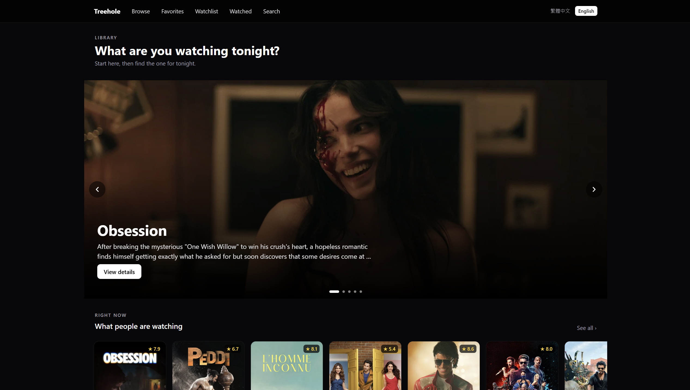
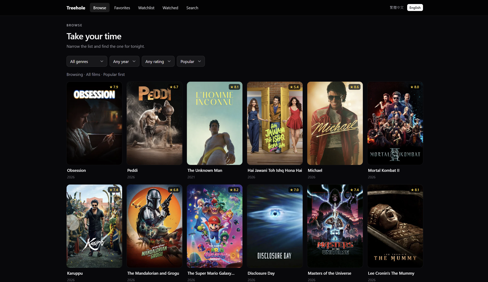
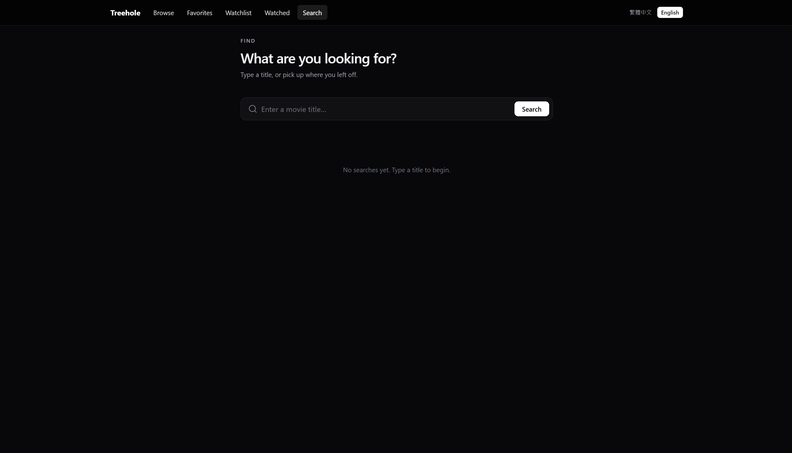
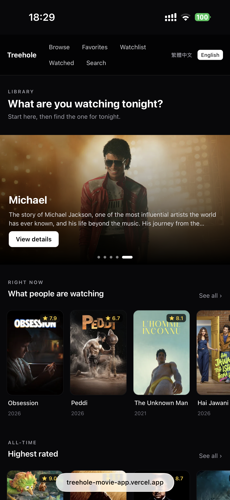

# Treehole

A cinematic movie discovery and private film library experience.

---

## Overview

Treehole is built around a specific kind of moment: you have an evening, you want to watch something, and you need a space that helps you find it — not just search a database.

The product has two layers. The first is a TMDB-powered discovery surface: a hero carousel, curated rows, browse by genre/year/rating, full-text search with recent search memory. The second is a private library: favorites, a watchlist, and a watched log that accumulates over time. Both layers share a consistent cinematic aesthetic — dark, poster-forward, restrained.

The app runs locally with a SQLite library. A Vercel demo is available for browsing and discovery; library persistence is intentionally disabled there rather than faked.

**Live demo:** https://treehole-movie-app.vercel.app

---

## Features

- **Cinematic home entry** — hero backdrop carousel + curated movie rows (trending, top rated, box office, upcoming)
- **Library-seeded recommendations** — uses watched and favorited films as seeds, then pulls related TMDB titles and deduplicates them into a "For You" row
- **Browse** — filter by genre, decade, minimum rating, and sort order; condition summary updates in real time
- **Search** — full-text TMDB search with recent search history (stored in SQLite, accessible without typing)
- **Movie detail page** — backdrop, poster, metadata, director link, cast strip, trailer embed, overview, personal rating editor
- **Library — Favorites / Watchlist / Watched** — sortable and filterable per-list views; cards have a hover-gated remove action (always visible on touch, hidden until hover on fine-pointer devices)
- **Personal ratings** — per-film score (1–10) and short note, stored locally
- **Personalized "For You" row** — appears on home once seeds exist in the library
- **i18n** — Traditional Chinese and English; language stored in cookie, no URL prefix needed
- **Demo-safe disabled states** — in demo mode, write actions (library, rating) are disabled with honest explanations rather than pretending to save

---

## Demo Mode vs Local Mode

| Area | Vercel Demo | Local Mode |
|---|---|---|
| TMDB discovery (home, browse, search, detail) | Yes | Yes |
| Favorites / Watchlist / Watched persistence | Disabled — shown with explanation | Available (SQLite) |
| Personal ratings | Disabled — shown with explanation | Available (SQLite) |
| Search history | Disabled | Available (SQLite) |
| Personalized recommendations | Disabled | Available once library has seeds |

Demo mode is set via `DEMO_MODE=1`. The DB layer swaps to a stub (`db.demo.ts`) that returns empty results for reads and no-ops for writes. Actions remain visible but show their disabled state — the goal is an accurate preview of local-mode UI without fake persistence.

---

## Product & Design Decisions

**Posters and backdrops are the primary visual material.** The detail page is built around the backdrop image with a gradient scrim; the poster anchors the metadata column. MovieCards use a lift-and-ring-reveal on hover. Nothing competes with the imagery.

**Dark UI for focus, not for aesthetics.** The zinc/black palette came from the use case — watching in the evening, low ambient light — not from trend-following. The one accent color is amber (ratings). No blue-to-purple gradients, no glow layers, no glassmorphism.

**Motion is used for orientation, not spectacle.** Entry animations (`.animate-rise`, `cubic-bezier(0.22, 1, 0.36, 1)`) indicate something has loaded. Library card removal uses `motion/react`'s `popLayout` so the grid reflows without visual pop. There is no scroll hijacking, no stagger cascade, no GSAP timeline.

**Demo mode does not fake persistence.** If an action is not available, it says so. The alternative — letting users click "Add to favorites" and having it silently disappear — would give a misleading picture of the product.

**Library pages are personal memory spaces, not management tables.** The header copy for each library page reflects how the list feels rather than what it does:
- Favorites: "The ones you kept" — *留下來的*
- Watchlist: "Waiting in line" — *排隊中*
- Watched: "Films you've seen" — *走過的*

**UI copy is part of product identity.** Browse says "Take your time" and "Narrow the list and find the one for tonight." Home says "Start here, then find the one for tonight." These are not placeholder text — they carry the product's voice.

---

## Tech Stack

| Layer | Choice |
|---|---|
| Framework | Next.js 16.2.6 (App Router, Turbopack) |
| UI | React 19, TypeScript |
| Styling | Tailwind CSS v4 |
| Animation | motion (framer-motion v12) |
| Local DB | better-sqlite3 (local mode only) |
| Movie data | TMDB API (v3 / v4 token) |
| Tests | Vitest |
| Deployment | Vercel (demo), Node 20+ LAN server (local) |

---

## Architecture

```
Browser
  └─ Next.js App Router (port 3100)
       ├─ Server components — TMDB data fetching, library reads
       ├─ Client components — interactivity (browse filters, hero,
       │   library actions, rating editor)
       ├─ Route handlers (/api/*) — library writes
       ├─ TMDB layer (src/lib/tmdb.ts) — all API calls server-side only
       ├─ DB layer (src/lib/db.ts / db.demo.ts) — swapped by DEMO_MODE
       └─ i18n (src/i18n/) — dictionary per locale, no URL prefix
```

**Key architectural choices:**

- The TMDB API key is accessed server-side only. Route handlers proxy requests so the browser never touches external APIs directly.
- The DB layer has two implementations: `db.ts` (real SQLite via better-sqlite3) and `db.demo.ts` (stubs). The switch is a single `DEMO_MODE` env var.
- i18n uses flat dictionaries (`dictionaries.ts`) with identical structure for zh-TW and en. Locale is stored in a cookie; the layout reads it on every request.
- No external auth, no cloud sync, no third-party account system. The data model is deliberately local-first.

---

## Local Setup

### Prerequisites

- Node.js 20 LTS or later
- A [TMDB API key](https://www.themoviedb.org/settings/api) (v3 key or v4 read access token)

### Installation

```bash
git clone https://github.com/zhuang060329-bit/treehole-movie-app.git
cd treehole-movie-app

npm install

cp .env.example .env
# fill in TMDB_API_KEY (required)

npm run dev
```

Open `http://localhost:3100`.

### Environment Variables

| Variable | Required | Description |
|---|---|---|
| `TMDB_API_KEY` | Yes | TMDB v3 api_key or v4 read access token |
| `DEMO_MODE` | — | Set to `1` to disable all writes (Vercel uses this) |

The dev and production servers bind to `0.0.0.0`, so other devices on the same network can reach the app at `http://<your-machine-ip>:3100`.

---

## Testing

43 tests across 5 files, covering utility functions:

| File | Coverage |
|---|---|
| `tmdb-utils.test.ts` | `pickTrailer` — trailer selection logic |
| `tmdb-error.test.ts` | `tmdbErrorMessage`, `isV4Token` — API error classification and key format validation |
| `images.test.ts` | `tmdbImage` — TMDB image URL construction |
| `genres.test.ts` | `genreOptions` — locale-aware genre list construction |
| `i18n-config.test.ts` | `normalizeLocale`, `tmdbLanguage`, `htmlLang` — locale mapping helpers |

These tests cover the utility layer. UI behavior and API integrations are not covered by the current test suite.

```bash
npm run test       # run once
npm run test:watch # watch mode
npm run typecheck  # tsc --noEmit
npm run build      # production build
```

---

## Screenshots

### Desktop

| Home | Browse |
|---|---|
|  |  |

| Search | |
|---|---|
|  | |

### Mobile

| Home |
|---|
|  |

> Detail-page screenshots are being re-shot after the current design pass.

---

## Future Improvements

- Expand integration tests around the demo/local DB boundary
- Optional: add a case study writeup for portfolio context
